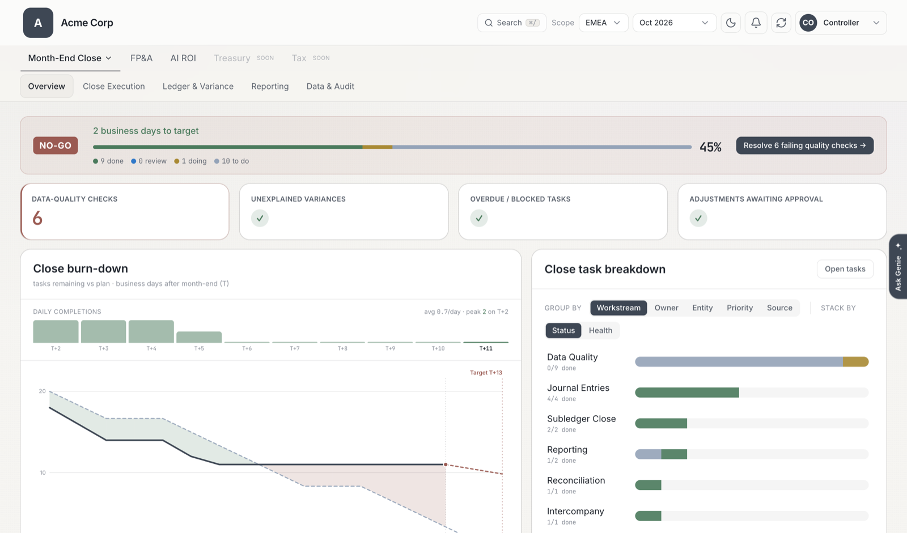
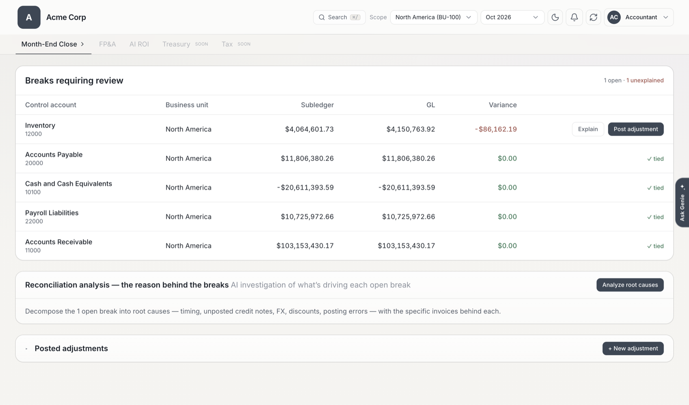
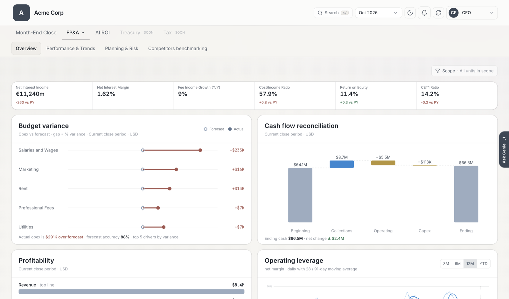

# Office of the CFO

A month-end close and FP&A app for finance teams, built on Databricks. It runs as
one Databricks App (React and FastAPI), comes with sample data for five
industries, and installs into your own workspace with one command.

Many finance teams run the close on spreadsheets that are hard to inventory,
validate or trace. This solution moves those spreadsheets, and every subledger
feed, onto one governed platform in Unity Catalog. Data-quality checks catch
reconciliation breaks and propose repairs for someone to approve. The trial
balance is computed from the governed data whenever it is read. Accountants post
adjustments in the app instead of in Excel, and controllers approve them. The CFO
asks questions in plain language through Genie, and every number traces back to
its source. On top of the close, the FP&A pages use 24 months of governed history
for trends, variance, scenarios and peer benchmarking.

All data is synthetic. Setup generates a sample company for each industry and
creates everything else in your workspace: the pipeline, a Lakebase project,
Genie spaces, dashboards and the app.

### What's in the app

1. **Close Dashboard** shows where the current close stands: tasks by owner,
   approvals waiting, and a data-quality badge that tells you whether today's
   numbers can be trusted.
2. **Reconciliation Breaks** lists subledgers that don't tie to the GL, with the
   invoices behind each gap. An accountant posts a correcting adjustment, a
   controller approves it (four-eyes), and the trial balance picks it up on the
   next refresh.
3. **Ask Genie** (bottom right) answers questions such as "What's our
   operating-expense variance to forecast this month, and which business unit is
   driving it?" from the same governed numbers.
4. **FP&A** covers variance against budget and prior year, 24 months of history,
   scenario planning, and benchmarking against listed peers' public filings. The
   model suggests the peers for the company you name at install.

Switch industry in **Settings**, and switch persona (CFO, Controller or
Accountant) in the top bar. The same screens change their labels and data scope
for each.

| Close Dashboard (Controller) | Reconciliation Breaks (Accountant) |
|---|---|
|  |  |



*Screenshots from a fresh install for a fictional company, "Acme Corp". The FP&A
overview shows the Financial Services industry.*

### Databricks terms used here

| Term | What it is here |
|---|---|
| **Unity Catalog** | Where all the governed finance tables live, with permissions and lineage. |
| **Lakeflow pipeline** | The ingest job that loads subledgers and close-folder spreadsheets and runs the data-quality checks. |
| **SQL warehouse** | The compute that runs the app's reports and the trial balance. |
| **Lakebase** | A managed Postgres database: the system of record for close tasks, adjustments and approvals. |
| **Genie** | Natural-language questions and answers over the governed tables. |
| **AI/BI dashboard** | A published dashboard (here, AI ROI for each industry). |
| **Databricks App** | Hosts the web app itself, running as its own service principal. |
| **Bundle** | `databricks.yml` and `resources/`: the infrastructure as code that creates all of the above. |

## Install in your workspace

### What you need

| | |
|---|---|
| **Workspace** | AWS or Azure, with Unity Catalog, serverless compute (SQL warehouses, Lakeflow pipelines, Databricks Apps), Lakebase Autoscaling, and AI Functions (`ai_query`, `ai_parse_document`). |
| **Permissions** | A workspace admin has everything needed. Otherwise you need permission to create serverless SQL warehouses, Lakebase projects, Databricks Apps, pipelines, jobs, Genie spaces and AI/BI dashboards. You also need either `CREATE CATALOG` on the metastore, or `USE CATALOG` and `CREATE SCHEMA` on an existing catalog. Setup grants the app's service principal access to the schemas it creates, which works because you own them. |
| **On your machine** | [Databricks CLI](https://docs.databricks.com/aws/en/dev-tools/cli/install) v1.20 or later, [uv](https://docs.astral.sh/uv/getting-started/installation/) and git. You only need Node.js to work on the frontend. |
| **Optional** | [Genie Code CLI](https://docs.databricks.com/aws/en/genie-code/genie-code-cli), for the guided install below. |

### Quick start

```bash
git clone https://github.com/databricks-industry-solutions/office_of_cfo.git office-of-cfo && cd office-of-cfo
databricks auth login --host https://<your-workspace-url> --profile my-workspace
uv run scripts/setup.py --profile my-workspace --company "<your company>"
```

`--company` is your company's name. The app shows it in the top bar, and the
Competitors benchmarking page asks the model for that company's listed peers. No
company is built into the code. If you leave `--company` out, setup asks for it.
Setup saves the name, so later runs reuse it. To change it, run setup again with
`--company "<new name>" --only app`.

Setup deploys the bundle, generates and loads the sample data, runs the close
pipeline and seeds the industries (all five by default). It then creates the Genie
spaces and AI/BI dashboards, grants the app access, starts the app and prints its
URL. A full install takes about 45 minutes, most of it seeding the five
industries, and stores under 10 MB of data. Setup prints `=== <step> ===` before
each step, and every step is idempotent: if one fails, fix the cause and resume
with `--from <step>`.

To install only some industries, add `--industries`, for example
`--industries consumer,fsi`. The app then lists only those, and each industry you
leave out saves about 7 minutes.

Setup creates a catalog called `office_of_cfo`. To use a catalog you already have
instead:

```bash
uv run scripts/setup.py --profile my-workspace --company "<your company>" --var catalog=<your_catalog>
```

### Install step by step with Genie Code

[Genie Code CLI](https://docs.databricks.com/aws/en/genie-code/genie-code-cli) reads
this repo's `AGENTS.md` and its install skill
(`.agents/skills/install-office-of-cfo/`), which tell it how to install the app and
what to ask you. Install Genie Code and start it from the repo root. When it asks
which profile to use for itself, pick one.

```bash
curl -fsSL https://github.com/databricks/genie-code-cli/releases/latest/download/install.sh | bash
cd office-of-cfo && genie
```

Then ask:

> Install the Office of the CFO app into my workspace.

Genie Code asks which Databricks CLI profile to install with, your company name,
which industries and catalog to use, and whether you want a different app name. It
checks the workspace, then runs setup in four stages and reports after each one.
It asks before every command that touches your workspace; approve each one. If
you'd rather run the commands yourself, these are the ones it runs:

1. **Check the workspace** (read-only): who you are, whether you're an admin,
   which catalogs you can use, and whether Lakebase Autoscaling and Apps respond.

   ```bash
   databricks current-user me --profile my-workspace
   databricks catalogs list --profile my-workspace
   databricks postgres list-projects --profile my-workspace
   databricks apps list --profile my-workspace
   ```

2. **Create the catalog and deploy the infrastructure**: the catalog (if it
   doesn't exist yet), the SQL warehouse, the Lakebase project with one database
   per industry, the close pipeline, the usage job and the app, which is still
   empty at this point.

   ```bash
   uv run scripts/setup.py --profile my-workspace --company "<your company>" --to deploy
   ```

3. **Load and seed the data**: loads the baseline company, runs the pipeline and
   copies the result into each industry. This is the longest stage, about 7
   minutes per industry.

   ```bash
   uv run scripts/setup.py --profile my-workspace --from data --to industries
   ```

4. **Set up access, Genie and dashboards**: grants the app's service principal
   access to the solution's schemas, then creates a curated self-service Genie
   space, plus an AI ROI Genie space and dashboard for each industry.

   ```bash
   uv run scripts/setup.py --profile my-workspace --from grants --to dashboards
   ```

5. **Start the app** and print its URL.

   ```bash
   uv run scripts/setup.py --profile my-workspace --only app
   ```

Open the URL, switch industries in **Settings**, and try the Genie window on the
Close Dashboard. **FP&A → Competitors benchmarking** lists the peers the model
suggests for your company. Setup saves the company and industries on the first
run, so the later commands don't repeat them. You can also ask Genie Code to
change the company, add an industry or run the app locally; it uses the same
skill.

### What gets created

| Resource | Name (defaults) | Notes |
|---|---|---|
| Unity Catalog schemas | `office_of_cfo.baseline_*`, `office_of_cfo.<industry>_{raw,close,serving,ops}` | 24 schemas of synthetic data, plus `app_ops` if you enable the usage job. |
| SQL warehouse | `office-of-cfo-warehouse` | Serverless, Small, stops after 10 idle minutes. |
| Lakebase Autoscaling project | `office-of-cfo` | One database per industry (`close_<industry>`), 0.5 to 2 CU, scales to zero after 5 idle minutes. |
| Lakeflow pipeline | `[default] Office of the CFO — Self-Healing Close` | Serverless; setup runs it once. |
| Job | `office-of-cfo-ai-gateway-usage-refresh` | **Paused.** Optional; needs `SELECT` on `system.ai_gateway`. |
| Databricks App | `office-of-cfo` | Runs as its own service principal. |
| Genie spaces | one self-service space, plus one AI ROI space per industry | `CAN_RUN` for the workspace `users` group (everyone in the workspace). |
| AI/BI dashboards | `AI ROI — <Industry>` | Published; `CAN_READ` for `users`. |

The bundle gives the app's service principal a Lakebase role that owns the five
`close_<industry>` databases, so the app creates its own tables on first use and
nothing needs attaching by hand. In Unity Catalog, setup grants the same service
principal `USE CATALOG`, plus read and write on the solution's schemas only. To
limit who can open the Genie spaces and dashboards, change their sharing after
setup.

The warehouse and Lakebase stop on their own when idle. The app's compute keeps
running until you stop it (`databricks apps stop office-of-cfo`) or remove the
solution.

### Configuration

Set any of these with `--var name=value` (setup passes them to every bundle
command), or create a git-ignored `databricks.local.yml` with your own target.

| Variable | Default | What it controls |
|---|---|---|
| `catalog` | `office_of_cfo` | The catalog for every schema the solution creates. Setup creates it if it's missing. |
| `app_name` | `office-of-cfo` | The app name; it also names the SQL warehouse. |
| `lakebase_project` | `office-of-cfo` | The Lakebase Autoscaling project id. |
| `close_period` | `2026-06` | The month-end that the sample data closes. |
| `industries` | all five | Comma-separated industries to install and show. Set it with `--industries`. |
| `company_name` | *(asked by setup)* | Your company: the name in the top bar, and the company whose peers benchmarking suggests. Set it with `--company`. |
| `contact_email` | the deploying user | The contact address for SEC EDGAR lookups. Set it if you deploy as a service principal. |

Setup fills in the Genie space and dashboard variables in `databricks.yml`, so you
don't set them. It records the ids it created in `.databricks/bundle/<target>/`
(git-ignored), so running it again updates the same spaces and dashboards instead
of creating new ones. To install a second, separate copy in the same workspace,
add a target in `databricks.local.yml` with different `app_name`,
`lakebase_project` and `catalog` values, and pass `--target <name>`.

### Remove it

```bash
uv run scripts/setup.py --profile my-workspace --teardown
```

After you type `delete` to confirm, this deletes the app, warehouse, Lakebase
project, pipeline, job, Genie spaces, dashboards and every schema the solution
created. It keeps the catalog itself, in case it holds anything else. If setup
created the catalog, drop it yourself (`DROP CATALOG office_of_cfo CASCADE`).

### Troubleshooting

| Symptom | Fix |
|---|---|
| `Could not create catalog …` | You don't have `CREATE CATALOG`. Run setup again with `--var catalog=<existing catalog>`, or ask an admin to create the catalog. |
| A step fails partway | Fix the cause and run setup again with `--from <step>`. Steps are idempotent. |
| Close Support or document extraction fails in `baseline` | `ai_parse_document` isn't available in your region or workspace. |
| Tasks, Approvals or Scenarios are empty | Check `databricks apps logs office-of-cfo` for `password authentication failed` or `lakebase circuit open`, then run setup with `--only deploy`, then with `--only app`. |
| Competitor benchmarking finds nothing | SEC EDGAR needs a contact email in the request header. The bundle sets it to the deploying user (`CFO_CONTACT_EMAIL`); check that it's in the app's environment. |
| No peer suggestions on Competitors benchmarking | The model suggests peers through `ai_query` on the `databricks-claude-sonnet-4-5` serving endpoint, which must be available in your workspace. The app drops peers that have no public structured filing, so a company whose competitors are private or don't file shows none. Search for them by name instead. |
| `No company name given` in a non-interactive run | Pass `--company "<company name>"`. |
| AI ROI shows no live AI Gateway usage | Expected until you unpause the usage job and grant it `SELECT` on `system.ai_gateway`. |

## How it works

### Five industries

The app serves five industries, each with synthetic FY2025 figures. Each one is a
generic company of its type. Its headline figures are illustrative and don't
match any real company's reported results.

| id | label | basis |
|------------|---------------------|--------------------|
| `consumer` | Consumer Goods | Global home & personal care and foods group |
| `software` | Software & SaaS | Global enterprise SaaS vendor |
| `fsi` | Financial Services | European retail & wholesale bank |
| `energy` | Energy & Utilities | Integrated energy company (USD) |
| `capmarkets` | Capital Markets | Global ETP market maker |

Each industry has its own data (`{catalog}.{industry}_{raw,close,serving,ops}`),
its own Lakebase database (`close_{industry}`) and its own headline KPIs. All
industries share the same pages, and you switch between them in **Settings**.

**Month-End Close** and **FP&A** are the two working modules. Treasury and Tax
appear in the module bar as placeholders. The command palette (⌘/) and the
**Genie** window are available from every page.

### Month-End Close

| Topic | Pages |
|-------|--------|
| Overview | Close Dashboard |
| Close Execution | Tasks, Approvals (four-eyes: post, approve, sign off) |
| Ledger & Variance | Trial Balance, Reconciliation Breaks |
| Reporting | Financial Statements |
| Data & Audit | Lineage & Data Quality |

Behind those pages:

- A spreadsheet on-ramp (Lakeflow Connect and Auto Loader) ingests close-folder
  spreadsheets and adapts when their columns change.
- A Lakeflow pipeline with built-in data-quality checks ingests the subledgers and
  the GL and flags breaks. A ZeroOps insights inbox proposes repairs, which a
  person approves.
- The trial balance is recomputed when it's read, so an adjustment posted in the
  app flows straight through.
- Reconciliation and adjustments run on **Lakebase** (Postgres), which holds the
  Accountant → Controller → CFO approval workflow and is the system of record for
  adjustments.
- Genie gives the CFO self-service answers, and Unity Catalog provides governance
  and lineage.

### FP&A

| Topic | Pages |
|-------|--------|
| Overview | Executive KPIs: working capital (DSO, DPO, DIO, CCC) and the industry's headline tiles |
| Performance & Trends | Variance Analysis, Historical Insights, Market Insights |
| Risk & Insights | Scenario Planning, Concentration Risk |
| Competitors benchmarking | Peers suggested for your company, their public filings, curated metrics and an AI note |

**Variance Analysis** compares the income statement, balance sheet and cash-flow
statement against budget, the prior period or the prior year, with driver
breakdowns, commentary and a visual dashboard.

**Historical Insights** shows how this month compares with history:

- KPI trend explorer (month on month and year on year)
- A normal range from the trailing average, with a z-score flag
- Area leaderboard (best and worst month on month)
- CCC drivers (DSO + DIO − DPO) with CCC overlaid
- Seasonality heatmap
- An `ai_query` narrative based on the computed metrics (left out when `ai_query` isn't available)

**Market Insights** shows commodity, macro and sector signals and driver
sensitivities, and links into Scenario Planning.

**Scenario Planning** projects P&L and cash from driver levers. You can draft,
commit and publish plans, and compare eligible plans with the baseline.

**Concentration Risk** is the live exposure graph. **Competitors benchmarking**
asks the model (`ai_query`) for the listed peers of the company you named at
install, keeps those whose public XBRL filings (ESEF or SEC EDGAR) yield metrics,
and benchmarks them. You can also search for any listed company by name or ticker.

Three more pages are built but hidden from the navigation: Payment Behaviour,
Stress Test and Inventory Exposure. Their APIs still work, and the generator still
builds the payment-behaviour profiles.

### History and the period picker

The sample data holds 24 months of history. The period picker in the top bar sets
the month for the reporting pages: Executive KPIs, Trial Balance, Financial
Statements, Variance Analysis, Exposure, Historical Insights and the other FP&A
reports. The close workflow (Tasks, Approvals, data quality and reconciliation)
always shows the active close.

The serving layer makes the accounting rules explicit:

- The balance sheet is cumulative through the selected period (a running total in
  `account_balance_asof`), so selecting a month shows the position at that
  month-end.
- The income statement and trial balance show that period's activity only.
- `kpi_history` is computed from the per-period GL at every scope: consolidated,
  region, legal entity, business unit and business line.

### Personas and scope

The same three personas apply to every industry:

- **CFO**: the consolidated view, read-only, with drill-down and Genie; signs off
  the close.
- **Controller**: one geography or business line, with KPIs, close readiness,
  variance and tasks.
- **Accountant**: the transactional workbench, with reconciliation, data quality,
  correcting entries and tasks.

The persona switcher in the top bar changes the navigation, the landing page and
the data scope. Scope follows the org hierarchy (Region → Country → Legal Entity →
Business Unit), crossed with Business Line, and every query is filtered to it. The
ids are the same in every industry; only the display names change.

### Source systems

The finance domains are synthetic subledgers, each labelled with a typical source
system: **SAP** (GL, AR, AP, Inventory, Product Costs, Sales Orders, Procurement,
Fixed Assets), **Workday** (Payroll, Staff Expenses), **AFAS** (the Netherlands
legal entity) and a **Bank Feed**. **Lineage & Data Quality** shows live coverage
(row counts and freshness) and order-to-cash and procure-to-pay lineage.

## For developers

The repo layout, local development and tests are in
[docs/DEVELOPMENT.md](docs/DEVELOPMENT.md). The rules for changing the app are in
[AGENTS.md](AGENTS.md), which Genie Code and other coding agents read too. In
short:

- One set of pages and components serves every industry. Per-industry differences
  go through the declarative `Overlay` in `app/frontend/src/lib/industries.ts`
  (labels, hidden pages, copy, feature flags) or through the industry's own data,
  never through `if (industry === ...)` branches.
- The active industry travels on every request in the `X-Industry` header.
- The UI is a hash-routed single-page app (`#/<page>`). The navigation is defined
  in `app/frontend/src/nav.ts`, and the hidden pages are listed in
  `GLOBALLY_HIDDEN_PAGES`.
- Everything lives in one catalog: the `baseline_*` schemas (one synthetic company,
  used to seed the industries and as the fallback when `CFO_MULTI_INDUSTRY=0`) and
  each industry's `{industry}_*` schemas.
- Catalogs, warehouses, Genie spaces, hosts and service principals come from the
  bundle, not from the code. See AGENTS.md → Deploying.

## Roadmap

Approved items and their target quarter. Status as of 2026-10-21; targets are
indicative and may move.

### Q4 2026

| Item | Area | Status |
|---|---|---|
| **AI ROI: Return on Tokens Used (ROTU)**: AI spend by business unit and project from Unity AI Gateway, benefits with evidence levels, break-even and portfolio view | New module | In development |
| **Cash flow forecasting**: driver-based forecast, single currency first | FP&A | In development |
| **Forecast accuracy**: track forecast vs actuals accuracy over time | FP&A | Planned |
| **Connected planning & budgeting**: extend forecast vs actuals into planning and budgets | FP&A | Planned |
| **Architecture diagram** of the solution | Docs | In development |
| **Minimum data requirements**: the key data needed to power the core features | Docs | In development |

## Contributing

1. **git clone** this project locally
2. Utilize the Databricks CLI to test your changes against a Databricks workspace of your choice
3. Contribute to repositories with pull requests (PRs), ensuring that you always have a second-party review from a capable teammate

## 📄 Third-Party Package Licenses

&copy; 2025 Databricks, Inc. All rights reserved. The source in this project is provided subject to the Databricks License [https://databricks.com/db-license-source]. All included or referenced third party libraries are subject to the licenses set forth below.

Only dependencies that are **actually distributed** in the published app are listed — the single-page frontend (built from `app/frontend/` by the Databricks Apps runtime on deploy) and the offline Python wheelhouse (`app/wheels/`). Build- and test-only tooling (Vite, TypeScript, Vitest, Playwright, PostCSS, Autoprefixer) is not shipped and is not listed. Full per-package attribution (version, project URL, copyright) is in [`NOTICE.md`](NOTICE.md).

| Package | License | Copyright |
|---------|---------|-----------|
| FastAPI | MIT | 2018 Sebastián Ramírez |
| Pydantic | MIT | 2017-present Pydantic Services Inc. and contributors |
| Uvicorn | BSD 3-Clause | 2017-present Encode OSS Ltd. |
| python-multipart | Apache 2.0 | 2012 Andrew Dunham |
| Databricks SDK for Python | Apache 2.0 | 2023 Databricks, Inc. |
| psycopg (binary, pool) | LGPL v3.0 &sup1; | 2020 The Psycopg Team |
| React / React DOM | MIT | Meta Platforms, Inc. and affiliates |
| Framer Motion | MIT | 2018 Framer B.V. |
| clsx | MIT | Luke Edwards |
| tailwind-merge | MIT | 2021 Dany Castillo |
| jsPDF | MIT | 2010-2021 James Hall and contributors; yWorks GmbH |
| jspdf-autotable | MIT | 2014 Simon Bengtsson |
| html2canvas | MIT | 2012 Niklas von Hertzen |
| canvg | MIT | 2010 Gabe Lerner and contributors |
| react-force-graph-2d / force-graph | MIT | 2018 Vasco Asturiano |
| d3-force-3d | MIT | 2010-2016 Michael Bostock; Vasco Asturiano |
| d3-sankey | BSD 3-Clause | 2015 Mike Bostock |
| lucide-react | ISC | 2022 Lucide Contributors |
| SheetJS (xlsx) | Apache 2.0 | 2012-present SheetJS LLC |
| DOMPurify | MPL-2.0 OR Apache 2.0 | 2015 Mario Heiderich |

&sup1; psycopg (LGPL v3.0) is distributed unmodified and dynamically linked / imported as a library, satisfying the LGPL distribution conditions. See the LGPL compliance note in [`NOTICE.md`](NOTICE.md).
